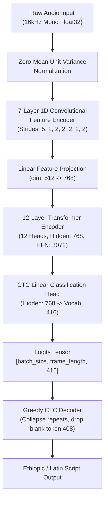

# Model Architecture & Engineering Design

This document details the underlying neural network architecture, ONNX conversion graph topology, quantization dynamics, and numerical validation methods used in the Ethio-ASR pipeline.

---

## 1. Acoustic & Model Architecture

The primary model is `badrex/Ethio-ASR-multilingual-94M`, based on the **AfriHuBERT / HuBERT (Hidden-Unit BERT)** self-supervised acoustic framework fine-tuned with Connectionist Temporal Classification (CTC).

### Key Hyperparameters
- **Base Architecture**: `HubertForCTC`
- **Total Parameters**: 94,690,848 (~94.7M parameters)
- **Feature Extractor Layers**: 7 1D Convolutional layers
  - Kernel sizes: `[10, 3, 3, 3, 3, 2, 2]`
  - Strides: `[5, 2, 2, 2, 2, 2, 2]` (Overall receptive field downsampling factor: 320x)
  - At 16,000 Hz, 1 second = 16,000 samples $\rightarrow$ ~49 to 50 temporal frames
- **Transformer Encoder**:
  - Hidden dimension: 768
  - Feed-forward intermediate dimension: 3,072
  - Attention heads: 12
  - Hidden layers: 12
- **Vocabulary Size**: 416 tokens
- **Padding / CTC Blank Token ID**: `408`

---

## 2. Audio Processing Contract

To ensure parity between training, Python inference, and mobile Kotlin execution, all inputs must strictly obey the following audio contract:

1. **Sampling Rate**: Exactly 16,000 Hz (16 kHz).
2. **Channel Format**: Mono (1 channel). Stereo audio must be averaged across channels:
   $$x_{\text{mono}} = \frac{x_{\text{left}} + x_{\text{right}}}{2}$$
3. **Data Type**: 32-bit floating point (`float32`).
4. **Normalization**: Zero-mean unit-variance normalization:
   $$\mu = \frac{1}{N}\sum_{i=1}^N x_i, \quad \sigma = \sqrt{\frac{1}{N}\sum_{i=1}^N (x_i - \mu)^2}$$
   $$\hat{x}_i = \frac{x_i - \mu}{\sigma + \epsilon}, \quad \text{where } \epsilon = 10^{-7}$$

---

## 3. ONNX Graph Topology & Export Strategy

### Input & Output Tensor Signatures
- **Input Name**: `input_values`
  - Shape: `[batch_size, sequence_length]` (e.g. `[1, 16000]` for 1 second)
  - Dynamic Axes: Axis 0 (`batch_size`), Axis 1 (`sequence_length`)
- **Output Name**: `logits`
  - Shape: `[batch_size, frame_length, 416]`
  - Dynamic Axes: Axis 0 (`batch_size`), Axis 1 (`frame_length`)

### Opset Version & Dynamic Lengths
The graph is exported with **ONNX Opset 17**. Dynamic shapes are essential for mobile deployment because user speech recordings vary from 1 second to 30+ seconds. By exporting with dynamic axes on `sequence_length`, the graph avoids hardcoded padding and excessive compute overhead on shorter utterances.

---

## 4. Quantization: FP32 vs FP16 vs INT8

| Feature | FP32 | FP16 | INT8 Dynamic |
| :--- | :--- | :--- | :--- |
| **Model Size** | 361.45 MB | 180.84 MB | **117.00 MB** |
| **Size Reduction** | Baseline | 50.0% | **67.6%** |
| **Target Hardware** | Desktop / Server CPU | GPU / Mobile NPU (FP16 support) | **Mobile CPU / Edge devices** |
| **Quantized Ops** | None | Cast weights to `float16` | Dynamic quant on `MatMul`, `Gemm` |
| **Max Abs Diff vs PyTorch** | 0.000016 | 0.007307 | 0.282805 |
| **Mean Abs Diff vs PyTorch** | 0.000002 | 0.000912 | 0.038104 |
| **RTF on 10s Audio (CPU)** | 0.493 | 0.570 | **0.290** |

### Why INT8 Dynamic Quantization is Recommended for Mobile CPU
1. **Memory Bandwidth Bottleneck**: On mobile CPUs, inference is typically memory-bandwidth bound rather than arithmetic-bound. Loading 117 MB of weights takes ~1/3 the memory bus bandwidth compared to 361 MB.
2. **Safe Logit Distribution**: Dynamic INT8 quantization only quantizes weight tensors in `MatMul` and `Gemm` operations to signed 8-bit integers while activations are quantized on the fly.
3. **No Calibration Dataset Required**: Unlike static INT8 quantization, dynamic quantization does not require calibrating activation ranges with representative audio, eliminating the risk of clipped activations on out-of-domain accents or background noise.

---

## 5. CTC Greedy Decoding Algorithm

The output of the model is an unnormalized 3D logits tensor of dimensions $[1, T, 416]$. The Greedy CTC decoding algorithm proceeds as follows:

1. **Argmax**: For each time frame $t \in [1, T]$, find the token index with the maximum probability:
   $$\hat{y}_t = \arg\max_{c \in [0, 415]} \text{logits}[0, t, c]$$
2. **Consecutive Duplicate Collapse**: Iterate through $\hat{y}_1, \dots, \hat{y}_T$ and remove contiguous repeated tokens:
   $$\text{collapsed} = [\hat{y}_t \text{ for } t \text{ where } \hat{y}_t \neq \hat{y}_{t-1}]$$
3. **Blank Token Filtering**: Remove all occurrences of the CTC blank token (`ID = 408`):
   $$\text{final\_tokens} = [k \text{ for } k \text{ in } \text{collapsed} \text{ if } k \neq 408]$$
4. **Vocabulary Mapping**: Map each remaining token ID to its corresponding Unicode character via `vocab.json`. Token `|` is replaced with an ASCII space (` `).
